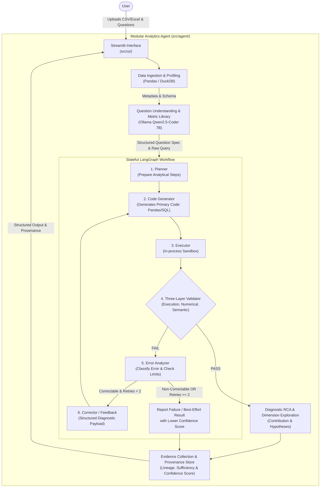

# Simplified Architecture Specification
## Self-Validating Autonomous Data Analytics Agent for Diagnostic & Evidence-Based Decision Support

Aligned directly with the Major Project Report (JIIT Noida) and finalized Three-Layer Validation Architecture.

---

## 1. System Architecture Overview



---

## 2. Core Components and Responsibilities

### 2.1 Streamlit UI (`src/ui/`)
- Cleanly separated under `src/ui/` (`app.py`, `components.py`, `charts.py`).
- Handles file upload (`.csv`, `.xlsx`), natural-language questions, and displays verified results, interactive Plotly charts, three-tier validation badges (`Execution`, `Numerical`, `Semantic`), ranked contributing factors, and inspectable evidence cards.

### 2.2 Data Ingestion & Automated Profiling (`src/agent/data/`)
- Ingests CSV and Excel files into Pandas and registers them in an in-memory DuckDB session.
- Automatically generates statistical summaries, data types, null counts, duplicate counts, and value distributions.
- Supplies compact summary metadata to the LLM—**never the entire raw dataset**.

### 2.3 Structured Question Understanding & Metric Library (`src/agent/analytics/`)
- **Metric Library:** Maintains standard analytical definitions (`SUM`, `COUNT`, `DISTINCT COUNT`, `AVG`, `Average Order Value (AOV) = SUM(sales)/COUNT(DISTINCT order_id)`, `Conversion Rate`, etc.).
- **Structured Specification:** The LLM maps the question to:
  - Metric name, aggregation, source column(s), and formula
  - Grouping dimensions
  - Filters (predicates, values, time constraints)
  - Sorting and grain requirements
- **Unsupported Metrics:** If a metric is not in the library, the LLM proposes a formula. If valid columns exist, it is flagged as *partially validated* or *newly interpreted*. If ambiguous, it triggers a clarification rather than false validation claims.
- **State Preservation Invariant:** Both the original natural-language question and this structured specification are preserved in the workflow state across planning, execution, and validation.

---

## 3. The Three-Layer Validation Architecture

```
                       [Generated Code & Analytical Spec]
                                       │
      ┌────────────────────────────────┼────────────────────────────────┐
      ▼                                ▼                                ▼
┌──────────────┐               ┌──────────────┐               ┌──────────────┐
│ Layer 1:     │               │ Layer 2:     │               │ Layer 3:     │
│ Execution    │               │ Numerical    │               │ Semantic     │
│ Validation   │               │ Validation   │               │ Validation   │
└──────┬───────┘               └──────┬───────┘               └──────┬───────┘
       │                              │                              │
       │ AST Syntax (ast/SQLGlot)     │ Independent Alternate Path   │ Plan/Code AST Inspection
       │ Runtime Exception Trap       │ (DuckDB SQL vs Pandas)       │ Actual Output Columns & Grain
       │ Timeouts & Resource Bounds   │ Standard Metric Library      │ Requirement Checklist Coverage
       │ Output Structure Integrity   │ Tolerance Check (atol=1e-4)  │ Filter & Dimension Preservation
       │                              │ Group Key & Row Count Match  │
       ▼                              ▼                              ▼
  [Status: P/F]                  [Status: P/F/INC]              [Status: P/F/INC]
       │                              │                              │
       └──────────────────────────────┼──────────────────────────────┘
                                      │
                                      ▼
                        [Final Validation Decision]
                        (Combines All Three Layers)
```

### 3.1 Layer 1: Execution Validation
- **Objective:** Determine whether the generated analytical code executes successfully and produces a usable result.
- **Deterministic Checks:**
  1. *Syntax Check:* `ast.parse()` for Python; `sqlglot.parse_one()` for SQL.
  2. *Runtime Exceptions:* Traps missing imports, undefined variables, missing columns, and type casting errors.
  3. *Resource Limits:* Execution timeout (default 10s) and memory constraints.
  4. *Output Structure Check:* Asserts output is a valid tabular structure (non-null DataFrame or Arrow table), not empty or corrupted.
- **Boundary:** Execution validation only proves code *ran without crashing*. It does **not** prove mathematical or semantic correctness.

### 3.2 Layer 2: Numerical Validation (Independent Calculation)
- **Objective:** Determine whether the analytical result is mathematically correct by independently recomputing it via an alternate engine.
- **No Redundant LLM Implementations:** The LLM generates **one** primary analytical implementation (Pandas or DuckDB).
- **Independent Re-computation:**
  - If primary implementation is **Pandas**, the numerical validator programmatically constructs and executes an independent **DuckDB SQL** query from the structured specification.
  - If primary implementation is **DuckDB SQL**, the numerical validator programmatically computes the result using pure vectorized **Pandas/NumPy**.
  - The validator does **not** execute the LLM's generated code twice.
- **Metric Library Grounding:** The validator uses predefined formulas from the Metric Library (e.g., `AOV = SUM(sales)/COUNT(DISTINCT order_id)`) rather than guessing formulas.
- **Numerical Comparator:**
  - Evaluates row counts, group keys, and numerical values within tolerance:
    $$\vert A - B \vert \le \text{atol} + \text{rtol} \times \vert B \vert \quad (\text{default atol}=10^{-4})$$
  - Handles null equality and scale-aware precision.
- **Statuses:** `PASS`, `FAIL`, `INCONCLUSIVE` (e.g. when metrics are unsupported or data is partially accessible).
- **Failure Policy:** If numerical validation fails after all retries, the system reports that numerical validation failed, flags the result as **UNVERIFIED**, and penalizes the confidence score according to the formula.

### 3.3 Layer 3: Semantic Validation (Question Correctness)
- **Objective:** Determine whether the generated plan, code, and output actually answer the user's original question (preventing cases where two implementations compute the identical wrong question, such as omitting a `year = 2017` filter).
- **Three-Step Semantic Auditing:**
  1. *Step 1: Structured Requirement Extraction:* Transforms the structured question JSON into a checklist: required metrics, aggregations, grouping dimensions, filter predicates, sorting, and output grain.
  2. *Step 2: Plan and Code Inspection:*
     - Uses `SQLGlot` to inspect SQL AST (or AST / execution metadata for Python).
     - Confirms that `WHERE` clauses contain all requested filters, `GROUP BY` matches requested dimensions, and aggregations match requested metrics.
  3. *Step 3: Actual Output Inspection & Coverage:*
     - Asserts that all expected columns exist in the final DataFrame.
     - Confirms result grain (e.g., one row per Region).
     - Confirms requested sorting order.
- **Coverage Policy:** Fails closed if any requested metric, dimension, filter, or time constraint was omitted during generation or execution.

---

## 4. Final Validation Decision Matrix

The final decision harmonizes all three layers:

| Execution Check | Numerical Check | Semantic Check | Combined Final Status | System Action |
| :---: | :---: | :---: | :---: | :--- |
| **PASS** | **PASS** | **PASS** | **PASS** | Result accepted, marked **VERIFIED**, passed to RCA/Reporting. |
| **FAIL** | Any | Any | **FAIL** | Code crashed/malformed; triggers Error Analyzer & Retry loop. |
| **PASS** | **FAIL** | Any | **FAIL** | Calculation discrepancy; triggers Error Analyzer & Retry loop. |
| **PASS** | **PASS** | **FAIL** | **FAIL** | Semantic mismatch (dropped filter/dimension); triggers Retry loop. |
| **PASS** | **INCONCLUSIVE** | **PASS** | **INCONCLUSIVE** | Accepted with caveat; flagged **PARTIALLY VALIDATED**, confidence penalized. |
| **PASS** | **PASS** | **INCONCLUSIVE** | **INCONCLUSIVE** | Accepted with caveat; flagged **PARTIALLY VALIDATED**, confidence penalized. |
| **PASS** | **FAIL** | **FAIL** | **FAIL** | Compound failure; triggers Error Analyzer & Retry loop. |

A result is marked **fully validated** ONLY when all three checks are **PASS**.

---

## 5. Self-Correction Cycle & Error Taxonomy

```
               [Planner]
                   │
                   ▼
           [Code Generator] ◄──────────────────┐
                   │                           │ (Attempt <= 2)
                   ▼                           │
              [Executor]                       │ Corrective Feedback
                   │                           │
                   ▼                           │
       [Three-Layer Validator]                 │
                   │                           │
         ┌─────────┴─────────┐                 │
         │                   │                 │
      (PASS)              (FAIL)               │
         │                   │                 │
         ▼                   ▼                 │
   [Accept Result]   [Error Analyzer] ─────────┘
                             │
                      (Terminal Fail)
                             │
                             ▼
               [Report Failure Honestly &
                Degrade Confidence Score]
```

### Error Taxonomy
- **Correctable Errors (Retry up to 2 times):**
  - Syntax error (AST parse error)
  - Column name typo (mapped against dataset schema)
  - Type casting error (date/string mismatches)
  - Calculation formula error (aligned with Metric Library)
  - Semantic omissions (missing filter or grouping restored)
  - Numerical mismatches (investigated with expected independent value)
- **Non-Correctable Failures (Immediate Stop, No Retry):**
  - Unsupported analytical operations (e.g. predictive ML)
  - Ambiguous user questions
  - Missing columns completely absent from dataset
  - Insufficient data (0 rows matching valid filters)

---

## 6. Confidence Score Formula

The evidence-confidence score $C \in [0.0, 1.0]$ is computed deterministically:

$$C = W_{\text{val}} \cdot S_{\text{val}} + W_{\text{data}} \cdot S_{\text{data}} + W_{\text{hyp}} \cdot S_{\text{hyp}} - P_{\text{retry}}$$

Where:
- $S_{\text{val}}$: Validation score (1.0 for all PASS; 0.5 for INCONCLUSIVE; 0.0 for FAIL).
- $S_{\text{data}}$: Data sufficiency score ($n \ge 30$, low null ratios).
- $S_{\text{hyp}}$: Hypothesis coverage score (variance explained by contributing factors).
- $P_{\text{retry}}$: Retry penalty (0.0 for 1st attempt; 0.1 for 2nd attempt; 0.5+ if correction failed, severely lowering confidence).
