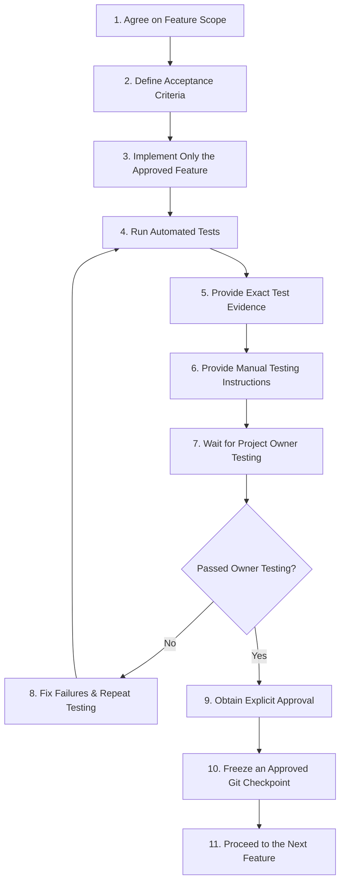

# Development Protocol: Self-Validating Autonomous Data Analytics Agent

## 1. Core Principle & Governance

This protocol establishes the **mandatory feature lifecycle** for developing this project. 

Development proceeds strictly **one feature at a time**. No feature may be started, implemented, or considered complete without following every step in this lifecycle in exact order.

**Rule Zero:** No feature can be marked approved without explicit, written project owner approval. Silent assumptions, premature feature branching, and batched implementations are strictly prohibited.

---

## 2. The 11-Step Mandatory Feature Lifecycle



### Step 1: Agree on Feature Scope
- Identify the exact feature ID (e.g., `F1.1: Tabular File Reader & Format Validator`) from `PROJECT_ROADMAP.md`.
- Confirm that all prerequisite features and phases are fully implemented, tested, approved, and frozen in Git.
- Define the precise boundaries: what is included, and explicitly what is excluded from this feature.
- Confirm agreement with the Project Owner before writing any code.

### Step 2: Define Acceptance Criteria
- Formulate concrete, unambiguous, binary (pass/fail) acceptance criteria.
- Specify:
  - Exact input schemas and types.
  - Expected outputs and return values.
  - Required exception types and failure handling.
  - Target latency or performance thresholds.
- Document the exact automated and manual test scenarios required to satisfy the criteria.

### Step 3: Implement Only the Approved Feature
- Write the minimum necessary production code to fulfill the agreed scope.
- Maintain strict typing (`mypy` compliant) and formatting (`ruff` compliant).
- Do not write speculative, dead, or future-phase code.
- Do not create empty directories or placeholder modules for subsequent phases.

### Step 4: Run Automated Tests
- Execute all unit, contract, and integration tests associated with the feature:
  ```bash
  pytest tests/unit/test_<feature>.py -v --cov=src/agent/<module>
  ruff check .
  mypy src/
  ```
- Ensure zero test failures, zero linting errors, and zero typing warnings.
- Run regression tests on all previously approved modules to guarantee zero breaking changes.

### Step 5: Provide Exact Test Evidence
- Document verbatim terminal outputs showing:
  - Full test execution trace and pass status.
  - Test coverage percentage for the newly introduced module.
  - Output of `ruff` and `mypy` checks.
- Do not abbreviate, fabricate, or summarize away test results. Real evidence is required.

### Step 6: Provide Manual Testing Instructions
- Provide the Project Owner with a step-by-step manual testing script, including:
  - Exact CLI commands or UI actions to execute.
  - Test inputs to provide (file paths, sample queries, button clicks).
  - Exact expected visible behaviors, UI states, or console outputs.
  - Edge cases or error conditions for the owner to deliberately test.

### Step 7: Wait for Project Owner Testing
- The agent halts execution and relinquishes control to the Project Owner.
- The Project Owner performs manual testing on their host machine.
- No further development or modification occurs while awaiting the Project Owner's evaluation.

### Step 8: Fix Failures and Repeat Testing (If Needed)
- If the Project Owner reports a defect, unexpected behavior, or unfulfilled criterion:
  - Analyze the root cause.
  - Implement a targeted fix within the feature scope.
  - Re-run all automated tests (Step 4).
  - Provide new test evidence (Step 5).
  - Provide updated manual verification steps (Step 6).
  - Return to Step 7.

### Step 9: Obtain Explicit Approval
- The Project Owner must issue an unambiguous written confirmation (e.g., *"Feature F1.1 is approved"*).
- Without this explicit message, the feature remains in review. The agent must never infer approval from silence or general conversation.

### Step 10: Freeze an Approved Git Checkpoint
- Commit the approved changes to Git with a conventional, structured commit message referencing the feature ID:
  ```bash
  git add src/ tests/
  git commit -m "feat(ingestion): complete F1.1 tabular file reader and format validator"
  git tag -a "checkpoint-F1.1" -m "Approved checkpoint for F1.1"
  ```
- Verify the repository working tree is clean.

### Step 11: Proceed to the Next Feature
- Update the feature tracking status in documentation.
- Transition to the next scheduled feature in `PROJECT_ROADMAP.md` and initiate Step 1.

---

## 3. Strict Non-Negotiable Rules

1. **No Application Code Without Approval:** Never implement application features or files during planning or architectural phases.
2. **Fail-Closed Gateways:** If a feature does not meet 100% of its acceptance criteria, it is failed. Partial or conditional approvals do not exist.
3. **Evidence Over Assertion:** Claims of functionality must always be accompanied by executable code and terminal output evidence.
4. **No Feature Bleed:** Under no circumstances may an implementation touch, anticipate, or scaffold components belonging to future phases.

