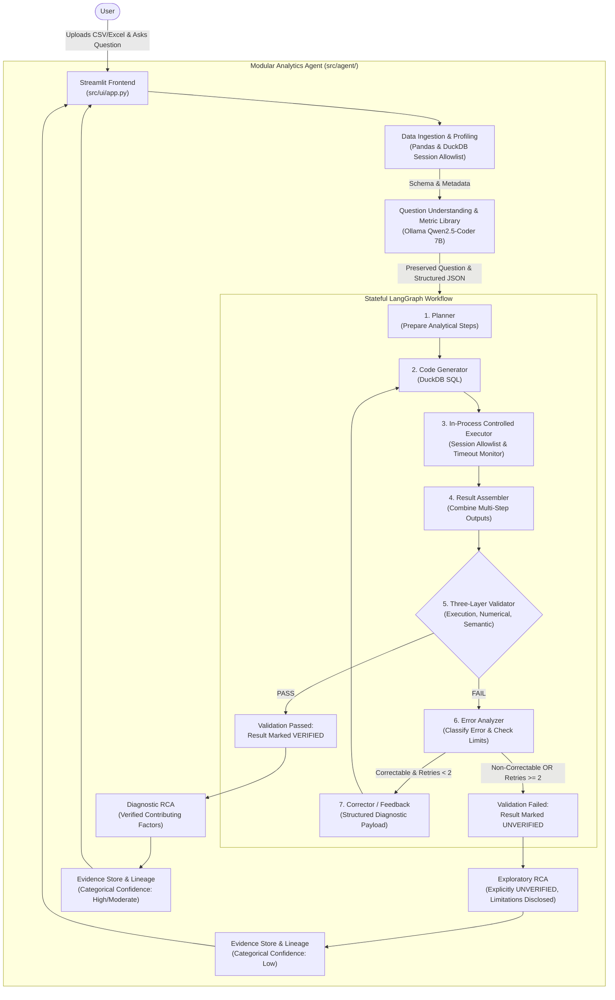

# Master Execution Plan: Self-Validating Autonomous Data Analytics Agent
## A B.Tech Major Project for Diagnostic & Evidence-Based Decision Support

- **Institution:** Jaypee Institute of Information Technology (JIIT), Sector 128, Noida
- **Degree:** B.Tech Computer Science & Engineering (7th / 8th Semester)
- **Project Team:** Parth Tiwari (9923103258) & Atul Sharma (9923103263)
- **Project Supervisor:** Mr. Noor Mohammad (Assistant Professor, Department of CSE)
- **Project Repository:** `major2.0`

---

## 1. Executive Summary & Core Architectural Invariants

This Master Execution Plan establishes the definitive, phase-by-phase implementation plan for building a **Self-Validating Autonomous Data Analytics Agent for Diagnostic and Evidence-Based Decision Support**.

The project addresses the fundamental vulnerability of LLM-based data analytics: LLMs can generate plausible SQL or Python code that runs without error yet computes the wrong quantity, drops user-specified filters, or invents unsupported explanations. This system bridges the gap between probabilistic LLM reasoning and mathematical truth through **deterministic independent calculation validation**, **semantic constraint preservation**, and **hypothesis-based diagnostic root-cause analysis**.

### Core Invariants Confirmed by Architecture Decisions (ADR-01 to ADR-12)
1. **Modular Monolith Architecture (ADR-01):** Implemented in pure Python. The presentation layer lives cleanly in `src/ui/` (Streamlit), and core agent logic lives in `src/agent/`. No microservices or external REST backends.
2. **Preserved Structured Question Interpretation (ADR-02):** The LLM parses questions into a lightweight structured JSON capturing metrics, aggregations, dimensions, filters, time constraints, and derived formulas. Both the raw question and this structured interpretation are preserved in the workflow state throughout execution and validation.
3. **Phased Scope Separation (ADR-03):** Phase 3 strictly proves single-step query execution. Phase 4 establishes the multi-step planning, state propagation, and result assembly workflow structure. Phase 5 implements the complete validation, error-analysis, and self-correction logic.
4. **Three-Layer Deterministic Validation (ADR-04):**
   - **Layer 1 (Execution):** Syntax validation (`ast.parse()`, `sqlglot`), execution safety policies, runtime exception traps, timeout management, session table allowlist enforcement, and scalar/tabular output validation.
   - **Layer 2 (Numerical):** Genuinely independent re-computation using pure vectorized Pandas/NumPy constructed from the structured analytical specification (never copied from generated SQL). Grounded in a standard `metric_library.py`. Uses SQL-matching semantics (`min_count=1` for all-null sums) and compound tolerance ($\text{atol} = 10^{-4}$, $\text{rtol} = 10^{-4}$).
   - **Layer 3 (Semantic):** Checklist coverage verifying that 100% of requested metrics, grouping dimensions, filters, and time constraints were implemented in the code/AST across supported scopes (CTEs, subqueries, scalar queries) and reflected in output grain. Conservative boundary: unverified or ambiguous equivalence transformations (especially date vs. timestamp intervals) return `INCONCLUSIVE`.
5. **Combined Validation Gate:** A result is marked **`VERIFIED`** ONLY when Execution, Numerical, and Semantic checks all pass.
6. **Bounded 7-Node Workflow & Self-Correction (ADR-08):** LangGraph coordinates 7 nodes: `Planner` $\rightarrow$ `Code Generator` $\rightarrow$ `Executor` $\rightarrow$ `Result Assembler` $\rightarrow$ `Validator` $\rightarrow$ `Error Analyzer` $\rightarrow$ `Corrector`. Retries are capped at `max_retries = 2`. Non-correctable failures halt immediately. Terminal failures honestly report unverified results with lowered confidence.
7. **Diagnostic RCA Coverage & Routing (ADR-05, ADR-12):** RCA is invoked for every eligible analytical query (including descriptive queries where candidate explanatory dimensions exist, and explicit "why" queries). Unverified results are never presented as verified contributions; if RCA is run on an unverified result, it is explicitly labeled **Exploratory Analysis (UNVERIFIED)** with full limitation disclosures. Initial RCA implements 1st-order dimensional variance decomposition ($\Delta M_i / \Delta M$). Contributions sum to 100% only when partitions are exhaustive, mutually exclusive, consistent, and $\Delta M \ne 0$.
8. **Categorical Confidence & Calibration Roadmap (ADR-06):** Transparent categories (**High**, **Moderate**, **Low**). Validation status is kept distinct from answer confidence. Successful self-correction on minor errors does not penalize confidence if all validation checks pass cleanly.
9. **Dynamic Table Registration (ADR-10):** Supports arbitrary user-uploaded CSV and Excel datasets. The execution engine dynamically maintains an allowlist of registered tables in the current DuckDB session.
10. **Three-Tier Testing Strategy:** Strict separation between fast offline unit tests (mocked LLM, passing 100% without Ollama), multi-component integration tests (real local Ollama), and end-to-end benchmark tests (real local model & real datasets).
11. **Phase-by-Phase Host Testing Governance (ADR-07):** After each phase, automated tests run, followed by mandatory manual testing by the Project Owner on the host machine before explicit sign-off. All phase dates are tentative, and all phase statuses remain **Pending** until tested and approved.

---

## 2. System Architecture & Workflow State Machine



---

## 3. Deep-Dive Design Specifications

### 3.1 Controlled In-Process Execution & Safety
The execution engine runs inside the host Python process using DuckDB's in-process engine (`duckdb.connect(":memory:")`). It is explicitly designed as a controlled in-process execution environment with static analysis and resource guards, rather than an OS-level sandbox container:

1. **Strict Read-Only SQL Policy:**
   - Every generated SQL statement is parsed into an AST via `sqlglot.parse_one(code, read="duckdb")`.
   - Rejects any DDL, DML, or modification statements: `INSERT`, `UPDATE`, `DELETE`, `DROP`, `ALTER`, `CREATE`, `REPLACE`, `TRUNCATE`.
2. **Dynamic Session Table Allowlist:**
   - Users may upload arbitrary CSV or Excel datasets. Upon ingestion, the dataset is registered under a sanitized identifier.
   - The engine maintains an active session allowlist: `session_tables = {"dataset", ...}`.
   - The AST is audited to ensure every referenced table identifier belongs to `session_tables`. Unregistered tables are rejected immediately.
3. **Rejection of External & Administrative Statements:**
   - Blocks statements containing `PRAGMA`, `ATTACH`, `DETACH`, `COPY`.
   - Blocks external table/file reading functions: `read_csv`, `read_parquet`, `read_json`, `httpfs`, or shell execution functions.
4. **Execution Timeout & Cancellation Limitations:**
   - Enforces a 10.0-second execution timeout.
   - **Empirical Interruption Limitation:** In Python, interrupting native C-extensions like DuckDB from a secondary thread via `connection.interrupt()` cannot be assumed to guarantee clean, immediate cancellation without empirical testing on the installed build. Furthermore, abandoning an un-cancelled thread in the background while opening a new connection does **not** guarantee safe resource recovery, as a running thread in native code may continue consuming CPU/memory or retain internal locks.
   - **Documented Execution Strategy:** During Phase 3, the exact behavior of `connection.interrupt()` will be empirically tested against the installed DuckDB package ($\ge 0.10.0$). If reliable cancellation within the timeout window cannot be empirically demonstrated, the system must either:
     a) Implement a separate process boundary (e.g., executing the query worker via Python `multiprocessing` where `process.terminate()` forcefully terminates the OS-level worker process), or
     b) Honestly document the remaining in-process thread timeout limitation in the system report.
5. **Handling Analytical Output Types:**
   - **Scalar Outputs:** Single-value aggregations (e.g. `SELECT SUM(sales) FROM dataset`) return a scalar value or single-cell DataFrame.
   - **Tabular Outputs:** Grouped queries return a multi-row, multi-column DataFrame.
   - **Valid Empty Results vs. Execution Failures:** A query that executes cleanly with valid syntax and schema but returns zero rows (e.g. valid filter where no records match) is treated as a **valid empty result** (`row_count = 0`), NOT an execution failure. Execution failures are strictly reserved for runtime syntax exceptions, missing columns, or database errors.

---

### 3.2 Numerical Validation: Independent Calculation Engine
Numerical validation proves calculation correctness by independently recomputing the result using pure vectorized Pandas/NumPy logic constructed directly from the structured analytical specification (**never copied or derived from the generated SQL**).

#### A. Metric-Specific Implementations & SQL Parity
- **`SUM` & All-Null Groups:**
  - In SQL, `SUM(col)` over an empty group or a group where all values are `NULL` produces `NULL` (not `0`).
  - Standard Pandas `.sum()` returns `0.0`. To guarantee exact SQL parity, the independent validator uses:
    ```python
    df[col].sum(min_count=1)
    ```
    This ensures that all-null groups evaluate to `NaN` (matching SQL `NULL`), while groups with at least one valid number evaluate to their correct sum.
- **`COUNT(*)` vs. `COUNT(column)`:**
  - `COUNT(*)` counts total rows in the group/slice, including rows where values are null: `len(group_df)`.
  - `COUNT(column)` counts only non-null values of the target column: `group_df[col].count()`.
- **`DISTINCT COUNT`:** `group_df[col].dropna().nunique()`. Excludes null values matching SQL `COUNT(DISTINCT col)` semantics.
- **`AVG`:** `group_df[col].mean(skipna=True)`. Returns `NaN` for slices with zero non-null values, matching SQL `NULL`.
- **`Average Order Value (AOV)` & Null-Sales Handling:**
  - `AOV` is a derived ratio: $\text{Numerator} / \text{Denominator}$.
  - **Orders with Valid IDs but All-Null Sales:** The system does not assume one universal business rule. The structured analytical specification must explicitly define whether orders with all-null sales are counted in the denominator:
    - *Definition A (Active Revenue Orders):* Counts only orders with at least one non-null sales value in the denominator:
      $$\text{Denominator} = \text{df}[\text{df}[\text{sales\_col}].\text{notna}()][\text{order\_id\_col}].\text{dropna}().\text{nunique}()$$
    - *Definition B (Total Placed Orders):* Counts all valid order IDs regardless of sales recording:
      $$\text{Denominator} = \text{df}[\text{order\_id\_col}].\text{dropna}().\text{nunique}()$$
    - If the user's intent is ambiguous from the question, the system requires clarification or explicitly discloses which definition assumption was applied.
  - Zero denominator guard: if $\text{Denominator} == 0$, returns `NaN`.
- **Group-Key Preservation (No Destructive Stripping):**
  - Grouping uses `df.groupby(dims, as_index=False, dropna=False)[col].agg(...)`.
  - In SQL, `GROUP BY` treats `NULL` as a valid distinct grouping bucket. `dropna=False` ensures Pandas creates an explicit group for rows with null grouping keys, matching SQL.
  - **No Whitespace Stripping:** The validator preserves original group-key string values exactly (e.g. `' West'` and `'West'` are distinct category values and must NOT be stripped or merged). Only semantics-preserving type normalization is performed (e.g. aligning `int64` and `float64` for identical numeric keys, or normalizing datetime representations to ISO strings).
  - Both result sets are sorted by the grouping keys to ensure exact 1-to-1 row alignment.

#### B. Analytical Assumptions: Duplicates, Returns, and Refunds
For transactional datasets (`superstore`, `online_retail`), the structured analytical specification must explicitly document:
1. **Cancelled Orders:** Whether orders with `status = 'Cancelled'` are filtered out.
2. **Returns & Refunds:** Whether negative sales/quantities are treated as returns reducing the net total or filtered out.
3. **Missing Order IDs:** Rows with null `order_id` are excluded from transaction distinct counts.
- **Intermediate Value Comparison:** For derived metrics like AOV, the validator evaluates intermediate components (numerator: sales sum delta; denominator: distinct order count delta) to pinpoint whether divergence stemmed from sales or order counts.

#### C. Compound Tolerance Checking
Numerical comparison evaluates both absolute and relative tolerances across all numeric cells:
$$|A - B| \le \text{atol} + \text{rtol} \times |B| \quad (\text{atol} = 10^{-4}, \text{rtol} = 10^{-4})$$

#### D. Unsupported / Novel Metrics
- If a metric is not present in `metric_library.py`, the LLM proposes an analytical formula.
- The system checks whether the proposed formula references existing dataset columns with compatible data types.
- If definition is clear: computes independent calculation, performs sanity/boundary checks, and assigns validation status **`INCONCLUSIVE` (Partially Validated)**.
- If definition is ambiguous: prompts for user clarification; **never falsely marks an unsupported metric as fully validated**.

#### E. Fundamental Limitation of Independent Calculation
- **Important Boundary:** An independent Pandas calculation validates that the generated SQL agrees with the **structured analytical specification**. It does **NOT** by itself prove that the LLM understood the user's natural-language question correctly.
- **Mitigation Strategy:**
  1. The original natural-language question is preserved and displayed alongside the verification report.
  2. Semantic validation audits prompt-to-AST coverage.
  3. Predefined canonical metrics from `metric_library.py` are preferred over unconstrained interpretation.
  4. Benchmark evaluations with known ground-truth question interpretations (Phase 8) assess intent extraction fidelity.

---

### 3.3 Semantic Validation: Three Comprehensive Checks
Semantic validation ensures that the plan, code, and output answer the user's actual question.

#### A. Requirement Checklist Extraction
Constructed directly from the preserved structured JSON:
- Required metric columns and aggregations.
- Grouping dimensions (empty list for scalar questions).
- Filter conditions (column, operator, target value).
- Time bounds and grains (e.g., Year = 2017).
- Sorting requirements (column and direction).
- Expected grain (e.g., one row per `[Region]`, or scalar single-value).

#### B. SQL AST Semantic Equivalence & Transformation Boundaries
The semantic validator does **not** enforce one rigid, hardcoded AST shape. It inspects whether the query's semantic logic satisfies all checklist requirements:
- **Supported, Tested Transformations:**
  - **Date vs. Timestamp Filtering:**
    - For genuine pure `DATE` columns: verifies inclusive boundaries (e.g. `order_date >= '2017-01-01' AND order_date <= '2017-12-31'`).
    - For `TIMESTAMP` columns: a full-year filter must use a **half-open interval**:
      ```sql
      order_date >= '2017-01-01' AND order_date < '2018-01-01'
      ```
      (or `order_date >= '2017-01-01 00:00:00' AND order_date <= '2017-12-31 23:59:59.999'`).
      Filtering with `<= '2017-12-31'` on a timestamp column is flagged as an error because it erroneously drops records timestamped on Dec 31 after 00:00:00.
    - Verified extraction equivalences: `strftime('%Y', order_date) = '2017'` and `EXTRACT(YEAR FROM order_date) = 2017`.
  - String matching: Normalizes `status = 'cancelled'`, `status ILIKE 'cancelled'`, `LOWER(status) = 'cancelled'`, or `status IN ('cancelled')`.
  - Aggregations: Normalizes `SUM(sales)` vs `SUM(sales * 1.0)`.
- **Equivalence Boundary (Date vs. Timestamp Intervals):** Automatic equivalence checks are strictly limited to supported, tested transformations. If equivalence cannot be established with certainty (for instance, converting date strings to timestamps where timezone offsets, time-of-day boundaries, or truncated intervals could alter the filter boundary), the semantic validator must return **`INCONCLUSIVE`** rather than falsely passing semantic validation.
- **Complex Query Scope Traversal (CTEs and Subqueries):**
  - Uses `ast.find_all(exp.Select)` and `ast.find_all(exp.CTE)` to inspect all query scopes.
  - If a filter is applied inside an inner CTE, the validator tracks that the constraint was enforced upstream and propagates to the final result.
  - Verifies that `GROUP BY` expressions are retained and match the requested dimensions.

#### C. Actual Result / Output Inspection
- **Scalar Queries:** If the user asked for an overall total (no grouping dimensions), verifies that the output contains exactly 1 row (or single scalar value) with the requested metric column.
- **Grouped Queries:** Verifies that all expected grouping dimension columns and metric columns exist in the materialized DataFrame.
- **Grain Verification:** Asserts that row count matches the number of unique group combinations in the data slice.
- **Sorting Verification:** For queries with sorting requirements, checks that output rows are monotonically non-increasing (for `DESC`) or non-decreasing (for `ASC`).
- **Original Question Preserved:** Retained throughout workflow state as the ultimate reference for human inspection.

---

### 3.4 Categorical Confidence Assessment & Calibration Roadmap

#### A. Transparent Categorical Confidence
Confidence is reported in three transparent, human-auditable categories (**High**, **Moderate**, **Low**), avoiding arbitrary mathematical weighting formulas:

| Confidence Category | Validation Status | Data Context & Assumptions |
| :---: | :---: | :--- |
| **High** | **`VERIFIED`** (Execution: PASS, Numerical: PASS, Semantic: PASS) | Standard metric library definition used, zero unresolved data ambiguities, clean group alignment. Note: If a self-correction on Attempt 2 cleanly fixed a minor syntax/alias error and passed all checks, confidence remains High. |
| **Moderate** | **`VERIFIED`** or **`PARTIALLY VALIDATED`** | Novel/unsupported metric with clear formula (partially validated), notable data sparsity in key segments, or minor non-standard assumptions made during question parsing. |
| **Low** | **`UNVERIFIED`** or **`INCONCLUSIVE`** | Numerical discrepancy between Pandas and DuckDB, missing requested filter/dimension, correction retries exhausted, execution failure, or severe data insufficiency. |

#### B. Separation of Validation Status vs. Answer Confidence
- **Validation Status:** Deterministic technical verdict on code execution, mathematical re-computation, and semantic coverage (`VERIFIED`, `PARTIALLY VALIDATED`, `UNVERIFIED`).
- **Answer Confidence:** Contextual assessment reflecting metric novelty, data limitations, and unresolved assumptions (`High`, `Moderate`, `Low`).

#### C. Empirical Calibration Roadmap (Phases 8 & 9)
In Phase 8 and Phase 9, benchmark evaluation across 50–100 questions with known ground truth will be used to calibrate empirical numerical probabilities ($P(\text{Correct} \mid \text{High Confidence})$).

---

### 3.5 Diagnostic Root-Cause Analysis (RCA) Coverage, Routing & Boundaries

#### A. RCA Eligibility & Workflow Routing
- **Eligibility:** RCA is invoked for **every eligible analytical query**—not only questions phrased as "why". An analytical query is eligible for RCA if candidate explanatory dimensions exist in the dataset (e.g. breakdowns by Region, Category, or Segment) and the user query explores performance, totals, or comparisons.
- **Routing Rules:**
  1. *Validation Passes (`VERIFIED`):* RCA executes on verified results, producing **Verified Contributing Factors**.
  2. *Validation Fails / Unverified (`UNVERIFIED`):* If the agent performs RCA on an unverified result after retries are exhausted, it must **never** present the findings as verified contributions. The output is explicitly labeled **Exploratory Analysis (UNVERIFIED)**, full limitations are disclosed, and confidence is set to **Low**.
  3. *Inconclusive / Insufficient Data:* If reliable diagnosis cannot be established, the system explicitly reports **insufficient evidence** rather than inventing contributing factors.

#### B. Additive Metrics (Exact Variance Decomposition)
- **Applicable Metrics:** Strictly additive sums (e.g., Total Sales, Total Profit, Total Quantity, Total Orders).
- **Mathematical Assumptions:** Contribution percentages may be reported as summing to 100% ONLY when:
  1. *Exhaustive:* Every row in the dataset belongs to a partition ($\bigcup S_i = S$).
  2. *Mutually Exclusive:* No row belongs to multiple partitions ($S_i \cap S_j = \emptyset$ for $i \ne j$).
  3. *Consistent:* The segmentation schema remains uniform between periods.
  4. *Non-Zero Total Change:* The total change $\Delta M \ne 0$.
- **Mathematical Invariant:**
  $$\Delta M = M_{\text{current}} - M_{\text{baseline}} \ne 0$$
  $$\Delta M_i = M_{i, \text{current}} - M_{i, \text{baseline}}$$
  $$\text{Contribution Share}_i = \frac{\Delta M_i}{\Delta M}$$
  $$\sum_{i=1}^k \Delta M_i = \Delta M \implies \sum_{i=1}^k \text{Contribution Share}_i = 100\%$$
- **Handling $\Delta M = 0$ or Non-Exhaustive Partitions:** If $\Delta M = 0$, dividing by zero is undefined; the system reports flat performance across segments with undefined contribution percentages. If partitions are overlapping or incomplete, the system discloses that exact additive partitioning does not hold and suppresses the 100% sum claim.

#### C. Non-Additive Metrics (Ratios, Averages, Percentages)
- **Mathematical Limitation:** Additive decomposition does **NOT** hold directly for averages (e.g. AOV), ratios (e.g. Profit Margin = Profit / Sales), or growth percentages ($\sum \Delta \text{Ratio}_i \ne \Delta \text{Ratio}$).
- **Handling Strategy:**
  1. Decompose the constituent additive metrics separately (e.g., analyze change in total Profit and change in total Sales independently).
  2. Perform segment-level distribution shift analysis.
  3. Transparently report: *"Additive decomposition cannot be applied directly to ratio/average metrics without constituent decomposition."*
- **Language Guardrails:** The system explicitly reports **contributing factors**, never claiming unproven definitive causality.

---

### 3.6 Three-Tier Testing Strategy

Testing is cleanly separated into three tiers to guarantee that unit tests run 100% offline without Ollama:

```
[Tier 1: Unit Tests]
 - Fast, isolated, deterministic
 - Mocked LLM responses (JSON fixtures)
 - Runs 100% offline without Ollama daemon
 - Asserts syntax, AST rules, metric math, min_count=1 null sums, tolerance checks
          │
          ▼
[Tier 2: Integration Tests]
 - Multi-component pipeline execution
 - Connects to real local Ollama (qwen2.5-coder:7b)
 - Tests live prompt understanding, plan generation, and SQL compilation
 - Real in-process DuckDB & Pandas execution
          │
          ▼
[Tier 3: End-to-End & Benchmark Tests]
 - Full user journey (upload -> prompt -> execute -> assemble -> validate -> report)
 - Real local Ollama + real datasets (superstore.csv, online_retail.csv)
 - 50–100 benchmark question evaluation
 - 5-configuration ablation study
```

---

## 4. Comprehensive 10-Phase Master Execution Plan

```mermaid
gantt
    title B.Tech Major Project Implementation Timeline (*Dates are tentative)
    dateFormat  YYYY-MM-DD
    section Phase 1 to 2
    Phase 1: Research, Requirements & Setup      :p1, 2026-11-17, 3d
    Phase 2: Dataset Preparation & Profiling    :p2, after p1, 5d
    section Phase 3 to 4
    Phase 3: Basic Analytics Engine (Single-Step):p3, after p2, 6d
    Phase 4: Autonomous Planning & LangGraph   :p4, after p3, 6d
    section Phase 5 to 6
    Phase 5: Three-Layer Validation & Correction:p5, after p4, 8d
    Phase 6: Diagnostic Root-Cause Analysis     :p6, after p5, 6d
    section Phase 7 to 10
    Phase 7: Evidence-Based Reporting & UI      :p7, after p6, 6d
    Phase 8: Benchmark & Evaluation (50-100 Qs) :p8, after p7, 5d
    Phase 9: Ablation Study & Optimization      :p9, after p8, 4d
    Phase 10: Final Documentation & Thesis      :p10, after p9, 5d
```
*Note: All timeline dates are tentative and subject to project owner approval at each milestone.*

---

### Phase 1: Research, Requirements & Project Setup
- **Status:** **Pending**
- **Goal:** Establish a clean, reproducible project configuration, dependency definitions, code quality tools, and local environment checks without application code.
- **Directory Artifacts Created:**
  - `pyproject.toml`
  - `.gitignore`
  - `README.md`
  - `tests/conftest.py`
  - `tests/unit/test_env_unit.py` (offline, mocked)
  - `tests/integration/test_env_ollama.py` (live Ollama check)
- **Minimal Dependencies Introduced:**
  ```toml
  dependencies = [
      "pandas>=2.0.0",
      "duckdb>=0.10.0",
      "numpy>=1.24.0",
      "sqlglot>=23.0.0",
      "httpx>=0.27.0",
      "pydantic>=2.6.0",
      "openpyxl>=3.1.0"
  ]
  dev-dependencies = [
      "pytest>=8.0.0",
      "pytest-cov>=4.1.0",
      "ruff>=0.3.0"
  ]
  ```
- **Step-by-Step Tasks:**
  1. Initialize `pyproject.toml` with project metadata, dependencies, and pytest configuration.
  2. Configure `.gitignore` to ignore `__pycache__`, `.venv`, `.pytest_cache`, and ephemeral database files.
  3. Author `tests/unit/test_env_unit.py` asserting Python version $\ge 3.10$ and verifying core imports pass **100% offline without Ollama**.
  4. Author `tests/integration/test_env_ollama.py` to check live Ollama HTTP reachability on `http://localhost:11434`.
  5. Run `ruff check .` to enforce linting standards.
- **Automated Testing:** `pytest tests/unit/test_env_unit.py -v`.
- **Manual Host Testing Instructions (Project Owner):**
  - Step 1: Create local virtual environment and install dependencies: `pip install -e ".[dev]"`.
  - Step 2: Run offline unit tests: `pytest tests/unit/ -v`.
  - Step 3: Start Ollama and run live environment check: `pytest tests/integration/test_env_ollama.py -v`.
- **Completion Criteria:** All environment checks pass with zero warnings/errors. Explicit user approval obtained.

---

### Phase 2: Dataset Preparation & Data Profiling
- **Status:** **Pending**
- **Goal:** Ingest arbitrary CSV and Excel files into Pandas and DuckDB with dynamic table registration, generate comprehensive structural and statistical profiles, and stage development datasets.
- **Directory Artifacts Created:**
  - `data/superstore.csv` (Standard 9,994-row retail sales dataset)
  - `data/online_retail.csv` (UCI transactional dataset)
  - `src/agent/data/__init__.py`
  - `src/agent/data/ingestion.py`
  - `src/agent/data/profiling.py`
  - `tests/unit/test_profiling.py`
- **Step-by-Step Tasks:**
  1. Populate `data/` with `superstore.csv` and `online_retail.csv`.
  2. Implement `ingestion.py`:
     - Load arbitrary `.csv` and `.xlsx` into a Pandas DataFrame.
     - Register the DataFrame into an in-memory DuckDB session (`duckdb.connect(":memory:")`) under a sanitized table name.
     - Add the table name to the active `session_tables` allowlist.
     - Handle file encoding (UTF-8, Latin-1) and sanitize column names (strip whitespace, replace special characters).
  3. Implement `profiling.py`:
     - Calculate row count, column count, and exact data types.
     - Compute null counts, null percentages, and duplicate row counts.
     - Extract distinct value counts for categorical dimensions.
     - Compute statistical summaries for numeric columns (min, max, mean, std, median, 25th/75th percentiles).
     - Build `serialize_profile_for_llm()`: formats compact metadata string ($< 1500$ tokens) containing table schema, date ranges, and top distinct values.
- **Automated Testing:** Unit tests in `tests/unit/test_profiling.py -v` (testing valid CSV/Excel loading, malformed files, null value extraction, dynamic table registration, and token budget limits).
- **Manual Host Testing Instructions (Project Owner):**
  - Run python one-liner to profile `data/superstore.csv` and print summary profile.
  - Confirm row count = 9,994, columns = 21, and sales/profit statistics match canonical numbers.
- **Completion Criteria:** Ingestion and profiling run in $< 1.0$s on Superstore. Explicit user approval obtained.

---

### Phase 3: Basic Analytics Engine (Single-Step & Simple JSON)
- **Status:** **Pending**
- **Goal:** Build the single-step analytics engine proving that the local model can parse questions into simple structured JSON, generate valid DuckDB SQL, and execute queries in-process with execution timeout guards.
- **Directory Artifacts Created:**
  - `src/agent/analytics/__init__.py`
  - `src/agent/analytics/ollama_client.py`
  - `src/agent/analytics/question_parser.py`
  - `src/agent/analytics/metric_library.py`
  - `src/agent/analytics/code_generator.py`
  - `src/agent/analytics/executor.py`
  - `tests/unit/test_analytics_unit.py` (mocked LLM)
  - `tests/integration/test_analytics_ollama.py` (live Ollama)
- **Step-by-Step Tasks:**
  1. Implement `ollama_client.py`: Async/sync client calling `http://localhost:11434/api/generate` with model `qwen2.5-coder:7b`, temperature 0.0, and timeout handling.
  2. Implement `metric_library.py`: Canonical definitions (`SUM`, `AVG`, `COUNT`, `DISTINCT COUNT`, `AOV = SUM(sales)/COUNT(DISTINCT order_id)`).
  3. Implement `question_parser.py`:
     - Prompts Ollama to extract structured JSON: `metric`, `aggregation`, `dimensions`, `filters`, `time_constraints`, `sorting`.
     - Validates basic JSON structure.
     - **Preserves both original question and structured JSON** in state dictionary.
  4. Implement `code_generator.py`: Generates read-only DuckDB SQL for single-step queries based on the structured interpretation, dynamic table name, and schema.
  5. Implement `executor.py`: Executes DuckDB SQL against the registered session, enforcing session table allowlist, timeout monitoring (10.0s), materialization ceiling (10,000 rows), and returns scalar or tabular results. Empirically tests DuckDB interruption behavior against the installed package version and documents verified fallback behavior.
- **Automated Testing:**
  - Unit: `pytest tests/unit/test_analytics_unit.py -v` (mocked responses, scalar vs tabular handling, timeout interrupts).
  - Integration: `pytest tests/integration/test_analytics_ollama.py -v` (live Ollama single-step generation).
- **Manual Host Testing Instructions (Project Owner):**
  - Run test script asking: *"What are the total sales by region in 2017?"*.
  - Inspect terminal output: confirm preserved structured JSON, generated DuckDB SQL, and resulting DataFrame.
- **Completion Criteria:** Reliable single-step query generation and execution. Explicit user approval obtained.

---

### Phase 4: Autonomous Planning & Agent Development (LangGraph)
- **Status:** **Completed** (Tag: `phase-4-complete`)
- **Goal:** Establish the multi-step planning, state propagation, and lightweight result assembly workflow structure using a 7-node LangGraph state graph.
- **Design Clarification:** Phase 4 establishes the graph topology, agent state schema, and multi-step execution pipeline (`Planner` $\rightarrow$ `Code Generator` $\rightarrow$ `Executor` $\rightarrow$ `Result Assembler`), while providing structural pass-through scaffolding for the validation nodes (`Validator`, `Error Analyzer`, `Corrector`) which are fully implemented in Phase 5.
- **Directory Artifacts Created:**
  - `src/agent/planning/__init__.py`
  - `src/agent/planning/state.py`
  - `src/agent/planning/planner.py`
  - `src/agent/planning/assembler.py` (Lightweight multi-step result assembly step)
  - `src/agent/planning/graph.py` (7-node workflow graph structure)
  - `tests/unit/test_planning_unit.py`
  - `tests/integration/test_planning_ollama.py`
- **Step-by-Step Tasks:**
  1. Implement `state.py`: Typed state dictionary holding:
     - `original_question`: str
     - `structured_question`: dict
     - `dataset_profile`: dict
     - `plan_steps`: list of dicts (`step_id`, `description`, `operation`, `dependencies`)
     - `current_step_index`: int
     - `step_results`: dict of dataframes / scalars
     - `retry_count`: int
     - `errors`: list of dicts
     - `final_result`: dict / dataframe
  2. Implement `planner.py`:
     - Detects question type (single-step descriptive vs multi-step comparative/trend).
     - Decomposes multi-step inquiries (e.g. *"Compare Q3 and Q2 revenue and find top declining categories"*) into sequential or parallel steps.
     - Ensures independent calculations are not forced into an artificial linear sequence.
  3. Implement `assembler.py`: Lightweight step that combines step results (e.g., merging period DataFrames or computing deltas) into the final structured analytical output without custom DAG frameworks.
  4. Implement `graph.py`: Assembles LangGraph 7-node state graph structure linking `Planner` $\rightarrow$ `Code Generator` $\rightarrow$ `Executor` $\rightarrow$ `Assembler` $\rightarrow$ `Validator` $\rightarrow$ `Error Analyzer` $\rightarrow$ `Corrector`.
- **Automated Testing:**
  - Unit: `pytest tests/unit/test_planning_unit.py -v` (mocked state transitions, multi-step result assembly).
  - Integration: `pytest tests/integration/test_planning_ollama.py -v` (live multi-step planning).
- **Manual Host Testing Instructions (Project Owner):**
  - Ask multi-step question: *"Compare sales between Technology and Furniture for 2017"*.
  - Verify that LangGraph executes Step 1 (Technology sales), Step 2 (Furniture sales), and combines them via the Assembler without failure.
- **Completion Criteria:** Multi-step analytical questions execute cleanly through LangGraph nodes. Explicit user approval obtained.

---

### Phase 5: Three-Layer Validation Architecture & Self-Correction
- **Status:** **Pending**
- **Goal:** Implement the complete three-layer deterministic validation engine (Execution, Numerical, Semantic) and activate the full self-correction feedback loop across the 7-node LangGraph state machine.
- **Directory Artifacts Created:**
  - `src/agent/validation/__init__.py`
  - `src/agent/validation/execution_validator.py`
  - `src/agent/validation/numerical_validator.py`
  - `src/agent/validation/semantic_validator.py`
  - `src/agent/validation/analyzer.py`
  - `src/agent/validation/correction.py`
  - `tests/unit/test_validation_unit.py`
  - `tests/integration/test_validation_correction.py`
- **Step-by-Step Tasks:**
  1. Implement `execution_validator.py` (Layer 1):
     - Syntax parsing via `sqlglot.parse_one(code, read="duckdb")`.
     - Enforces read-only safety, dynamic session table allowlist, and blocks external statements/PRAGMA.
     - Runtime error trapping (catches missing tables, column typos, execution exceptions).
     - Distinguishes valid empty result sets from crashes; asserts scalar or tabular structure integrity.
  2. Implement `numerical_validator.py` (Layer 2):
     - Receives structured analytical specification and raw Pandas DataFrame.
     - Implements metric-specific logic (`SUM` with `min_count=1`, `COUNT(*)` vs `COUNT(col)`, `DISTINCT COUNT`, `AVG`, `AOV` with null-sales definitions, null group keys via `dropna=False`, zero denominator guards).
     - Evaluates intermediate components (e.g. numerator sales sum and denominator distinct order count).
     - Handles unsupported metrics with transparency (marks `INCONCLUSIVE`, never claims full verification).
     - Compares primary DuckDB result vs independent Pandas result using compound tolerance ($|A - B| \le \text{atol} + \text{rtol} \times |B|$).
  3. Implement `semantic_validator.py` (Layer 3):
     - Extracts requirement checklist from preserved structured question JSON.
     - Inspects generated DuckDB SQL AST with `SQLGlot` across all scopes (CTEs, subqueries) accounting for supported, tested equivalent expressions.
     - Enforces exact date/timestamp interval boundaries (half-open intervals for timestamps). Flags unverified or ambiguous transformations as `INCONCLUSIVE`.
     - Supports scalar queries (0 dimensions) and grouped queries (verifying output grain).
     - Fails closed if any user filter or dimension was dropped.
  4. Implement `analyzer.py` & `correction.py`:
     - Implements Combined Decision Matrix (All 3 must pass for `PASS`).
     - Classifies errors: correctable vs non-correctable.
     - Builds feedback payload (original question, plan, generated code, error message, independent expected value, attempt number).
     - Caps retries at `max_retries = 2`.
     - Terminal failure: Reports error honestly, marks result `UNVERIFIED`, and sets confidence to **Low**.
  5. Connect full validation and correction logic into the LangGraph state machine (`graph.py`).
- **Automated Testing:**
  - Unit: `pytest tests/unit/test_validation_unit.py -v` (isolated testing of execution traps, numerical tolerances, all-null SUM groups with `min_count=1`, CTE AST inspection, date/timestamp interval boundary, and scalar queries).
  - Integration: `pytest tests/integration/test_validation_correction.py -v` (injected error self-correction with live Ollama).
- **Manual Host Testing Instructions (Project Owner):**
  - Inject intentional calculation error (e.g. AOV written as `AVG(sales)`).
  - Verify terminal output shows: Attempt 1 fails Numerical Check $\rightarrow$ Feedback dispatched $\rightarrow$ Attempt 2 generates `SUM(sales)/COUNT(DISTINCT order_id)` $\rightarrow$ All 3 checks PASS.
- **Completion Criteria:** All three validation layers active; bounded self-correction verified. Explicit user approval obtained.

---

### Phase 6: Diagnostic Root-Cause Analysis (RCA) & Dimension Exploration
- **Status:** **Pending**
- **Goal:** Implement diagnostic analytics to decompose observed metric changes across dimensions and explore drivers for descriptive queries within mathematical boundaries.
- **Directory Artifacts Created:**
  - `src/agent/diagnostics/__init__.py`
  - `src/agent/diagnostics/hypotheses.py`
  - `src/agent/diagnostics/contribution.py`
  - `tests/unit/test_diagnostics_unit.py`
  - `tests/integration/test_diagnostics_integration.py`
- **Step-by-Step Tasks:**
  1. Implement `contribution.py`:
     - 1st-order dimensional variance decomposition restricted strictly to additive metrics: $\Delta M = M_{\text{current}} - M_{\text{baseline}}$.
     - Asserts mathematical conditions: segment partitions must be **exhaustive, mutually exclusive, and consistent** across periods, and **$\Delta M \ne 0$**.
     - Computes segment contributions: $\Delta M_i = M_{i, \text{current}} - M_{i, \text{baseline}}$.
     - Contribution percentage: $\text{Share}_i = \Delta M_i / \Delta M$.
     - Asserts mathematical exactness: $\sum \Delta M_i = \Delta M$ (sums cleanly to 100%).
     - If $\Delta M = 0$, reports flat performance and flags percentage contribution as undefined.
     - If partitions are incomplete or overlapping, reports the limitation and suppresses the 100% sum claim.
     - For non-additive metrics (ratios, averages), decomposes constituent additive metrics or transparently reports that additive decomposition cannot be applied directly.
  2. Implement `hypotheses.py`:
     - Invoked for all eligible queries (including descriptive queries where dimension exploration is relevant).
     - If validation is `PASS`: produces verified contributing factors.
     - If validation is `UNVERIFIED`: explicitly labels output as **Exploratory Analysis (UNVERIFIED)** with limitations disclosed.
     - Formulates candidate hypotheses across dimensions (e.g., Regional decline, Product Category decline, Customer Segment drop).
     - Tests each hypothesis against the data using contribution analysis.
     - Ranks contributing factors by magnitude of impact.
     - Explicitly labels results as **contributing factors**, not definitive causality.
     - If reliable diagnosis cannot be established, reports *"Insufficient evidence to determine a reliable contributing factor"*.
- **Automated Testing:**
  - Unit: `pytest tests/unit/test_diagnostics_unit.py -v` (mathematical sum-to-100% check, delta=0 check, invalid/incomplete partition detection, non-additive error handling).
  - Integration: `pytest tests/integration/test_diagnostics_integration.py -v` (hypothesis generation, ranking, verified vs. unverified exploratory routing).
- **Manual Host Testing Instructions (Project Owner):**
  - Test 1 (Valid Partition): Ask diagnostic inquiry: *"Why did profit decline in 2017 compared to 2016?"* (baseline = 2016, current = 2017). Verify breakdown of profit variance by Category (e.g. Tables/Furniture contributing to loss) with exact percentage contributions summing to 100%.
  - Test 2 (Zero Delta): Run query comparing identical periods (e.g. 2016 vs 2016). Verify system handles $\Delta M = 0$ cleanly without division-by-zero crashes.
  - Test 3 (Incomplete Partition): Run query on overlapping or non-exhaustive dimension. Verify system suppresses 100% claim and reports partition limitation.
- **Completion Criteria:** Watertight 1st-order variance decomposition, boundary testing, and hypothesis ranking. Explicit user approval obtained.

---

### Phase 7: Evidence-Based Reporting & Streamlit UI
- **Status:** **Pending**
- **Goal:** Build the complete, interactive Streamlit application located cleanly in `src/ui/`, featuring validation status cards, Plotly charts, and evidence provenance drawers.
- **Directory Artifacts Created:**
  - `src/agent/reporting/__init__.py`
  - `src/agent/reporting/provenance.py`
  - `src/agent/reporting/confidence.py`
  - `src/ui/__init__.py`
  - `src/ui/app.py`
  - `src/ui/components.py`
  - `src/ui/charts.py`
  - `tests/unit/test_reporting_unit.py`
  - `tests/integration/test_ui_app.py`
- **Minimal Dependencies Added:**
  - `streamlit>=1.32.0`
  - `plotly>=5.19.0`
- **Step-by-Step Tasks:**
  1. Implement `provenance.py`: Stores audit record per query (dataset hash, user question, structured JSON, primary SQL, independent calculation, execution time, validation report, retry logs).
  2. Implement `confidence.py`: Computes transparent categorical confidence (**High**, **Moderate**, **Low**) based on validation status, data limitations, and unresolved assumptions.
     - Keeps validation status strictly separate from answer confidence.
     - Successful self-corrections on minor errors that pass all validation gates retain **High** confidence.
  3. Implement `charts.py`: Generates responsive Plotly charts (bar, line, scatter) from verified DataFrames.
  4. Implement `components.py`: Streamlit cards for Three-Tier Validation badges (`Execution: PASS`, `Numerical: PASS`, `Semantic: PASS`), categorical confidence pills, and collapsible evidence provenance drawers.
  5. Implement `app.py`: Streamlit entry point unifying file upload, query box, report rendering, and error warnings.
- **Automated Testing:** `pytest tests/unit/test_reporting_unit.py -v` (categorical confidence assignment and provenance serialization).
- **Manual Host Testing Instructions (Project Owner):**
  - Run `streamlit run src/ui/app.py`.
  - In browser: Upload `superstore.csv`, enter analytical question, verify execution, view Plotly chart, check green validation badges, view categorical confidence badge, and expand evidence drawer.
- **Completion Criteria:** Responsive, beautiful Streamlit interface demonstrating complete workflow. Explicit user approval obtained.

---

### Phase 8: Benchmark & Evaluation (50–100 Questions)
- **Status:** **Pending**
- **Goal:** Evaluate the system against a standardized suite of 50–100 analytical questions covering diverse query archetypes.
- **Directory Artifacts Created:**
  - `tests/benchmark/benchmark_questions.json`
  - `tests/benchmark/run_benchmark.py`
  - `tests/benchmark/evaluate_metrics.py`
- **Step-by-Step Tasks:**
  1. Construct `benchmark_questions.json` with 50–100 questions categorized into:
     - *Simple Descriptive:* Single metric, single group, or scalar queries.
     - *Multi-Step Comparative:* Comparing periods, top-N filters, multi-dimension aggregations.
     - *Diagnostic "Why" Questions:* Root cause queries requiring contribution analysis.
     - *Insufficient Evidence Questions:* Questions asking for variables not in dataset (e.g., weather, customer age).
  2. Implement `run_benchmark.py`: Automated batch runner iterating through questions, executing agent, and logging metrics.
  3. Compute evaluation metrics:
     - Analytical accuracy (%)
     - Calculation error rate (%)
     - Validation accuracy (%)
     - Self-correction success rate (%)
     - Unsupported claim rate (%)
     - Evidence completeness (%)
     - Average response time (s)
  4. Build empirical accuracy calibration curves to prepare for Phase 10 numerical calibration.
- **Automated Testing:** `python tests/benchmark/run_benchmark.py`.
- **Manual Host Testing Instructions (Project Owner):**
  - Inspect generated `benchmark_summary.json` and review accuracy across question categories.
- **Completion Criteria:** Benchmark runner completes with $< 5\%$ calculation error rate on supported queries. Explicit user approval obtained.

---

### Phase 9: Ablation Study & Optimization
- **Status:** **Pending**
- **Goal:** Execute the formal ablation study across 5 configurations defined in the project report (Table 5) to quantify the exact value of deterministic validation and RCA.
- **Directory Artifacts Created:**
  - `tests/benchmark/ablation_runner.py`
  - `tests/benchmark/ablation_results.json`
- **Configurations Evaluated:**
  1. **C1 (LLM-only):** LLM generates direct answer without code execution.
  2. **C2 (LLM + Code Execution):** Generates and runs code; no validation.
  3. **C3 (LLM + Validation):** Code execution with 3-layer validation & self-correction; no RCA.
  4. **C4 (LLM + Validation + RCA):** Adds hypothesis testing and variance decomposition.
  5. **C5 (Complete Proposed System):** Full agent with Validation, RCA, and Evidence Provenance.
- **Step-by-Step Tasks:**
  1. Implement `ablation_runner.py` running benchmark subset across all 5 configurations.
  2. Measure and tabulate error rates, hallucination rate, and execution latencies.
  3. Generate comparative charts for inclusion in final thesis.
- **Automated Testing:** `python tests/benchmark/ablation_runner.py`.
- **Manual Host Testing Instructions (Project Owner):**
  - Review comparative ablation tables showing clear reduction in calculation errors from C1/C2 to C3/C5.
- **Completion Criteria:** Empirical proof generated confirming validation dramatically improves reliability. Explicit user approval obtained.

---

### Phase 10: Documentation & Final Project Report
- **Status:** **Pending**
- **Goal:** Finalize academic thesis chapters, presentation slides, reproducibility documentation, and project demonstration materials.
- **Deliverables:**
  - Complete Major Project Report (`.pdf` / LaTeX source) structured per JIIT requirements.
  - Final viva presentation slide deck (`.pptx` / PDF).
  - Clean `README.md` with one-command setup and faculty demonstration scripts.
- **Step-by-Step Tasks:**
  1. Document system architecture, mathematical formulas, and validation algorithms.
  2. Embed benchmark and ablation results into report tables and figures.
  3. Prepare live demonstration scenario (upload dataset $\rightarrow$ query $\rightarrow$ self-correction demo $\rightarrow$ diagnostic RCA $\rightarrow$ evidence inspection).
- **Completion Criteria:** Complete academic deliverables finalized, rehearsed, and signed off.

---

## 5. Verification Checkpoint Governance

Before progressing from any phase to the next, the following **Feature Checkpoint Gate** must be satisfied:

```
[Phase Implementation Complete]
              │
              ▼
[Automated Tests Pass] ──► ruff check . && pytest tests/...
              │
              ▼
[Terminal Test Evidence Documented]
              │
              ▼
[Manual Testing Script Provided to Project Owner]
              │
              ▼
[Project Owner Performs Host Verification]
              │
       ┌──────┴──────┐
       │             │
   (Issues)      (Approved)
       │             │
       ▼             ▼
[Targeted Fix]  [Git Checkpoint Tagged: git tag checkpoint-phase-X]
                     │
                     ▼
             [Proceed to Phase X+1]
```

---

> [!IMPORTANT]
> **Current Workspace Status:**
> - Master execution plan and all architectural blueprints are synchronized in [`docs/`](file:///Users/aditisharma/Desktop/major2.0/docs).
> - **Zero application code has been written.**
> - All phases remain **Pending** awaiting explicit project owner approval.
