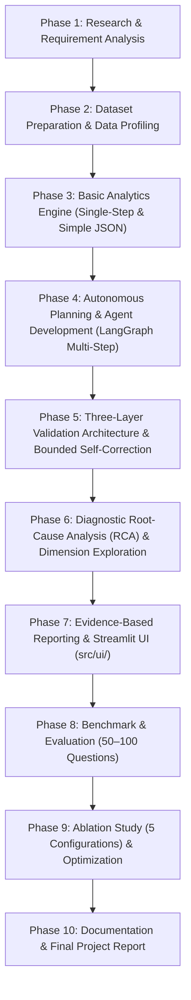

# Project Roadmap: Self-Validating Autonomous Data Analytics Agent
## Simplified 10-Phase B.Tech Major Project Plan

Aligned directly with the **JIIT Major Project Work Plan (Chapter 8)** and finalized Three-Layer Validation Architecture.

---

## Governance & Manual Testing Rule
**Mandatory Phase Sign-off:** After each phase is implemented and automated tests pass, the **Project Owner (User)** must manually test the software on their host environment according to provided instructions. Explicit approval must be received before moving to the next phase.

---

## Overview Workflow & Phase Dependencies

---

## Phase 1: Research & Requirement Analysis
- **Goal:** Formalize functional/non-functional requirements, project scope, literature baseline, and initial environment specifications.
- **Modules/Artifacts:** `docs/`, environment definition, baseline project configurations.
- **Inputs:** Literature review, problem statement, project report requirements (FR1–FR14, NFR1–NFR10).
- **Outputs:** Approved architecture specifications and finalized development guidelines.
- **Acceptance Criteria:** Clear definition of in-scope vs. out-of-scope capabilities; agreed technology stack.
- **Manual Verification (User):** Review and approve all blueprint documents in `docs/`.

---

## Phase 2: Dataset Preparation & Data Profiling
- **Goal:** Ingest CSV and Excel datasets, generate automated structural and statistical profiles, and prepare benchmark datasets.
- **Minimum Required Modules:** `src/agent/data/ingestion.py`, `src/agent/data/profiling.py`.
- **Inputs:** CSV / Excel files (UCI Online Retail dataset, Superstore, synthetic diagnostic datasets).
- **Outputs:** Dataframe / DuckDB table registration and a JSON-serializable `DataProfile` (row/column counts, data types, null counts, distinct values, basic summary statistics).
- **Acceptance Criteria:**
  - Loads standard tabular datasets without encoding errors.
  - Generates summary statistics and compact metadata string for LLM context without sending full raw datasets.
- **Automated Tests:** Unit tests for CSV/Excel parsing, null value detection, and statistical summary calculation (`tests/test_profiling.py`).
- **Manual Verification (User):** Load sample dataset (e.g. Superstore) and inspect printed/logged summary profile.

---

## Phase 3: Basic Analytics Engine (Single-Step & Simple JSON)
- **Goal:** Prove that the model can answer simple, single-step analytical questions using generated code, without introducing a complex planner or elaborate Pydantic contract framework.
- **Design Principles:**
  - Use simple model-generated JSON to capture: metrics, aggregations, grouping dimensions, filters, time constraints, and derived calculations.
  - Introduce `metric_library.py` with standard analytical metrics (`SUM`, `COUNT`, `DISTINCT COUNT`, `AVG`, `AOV = SUM(sales)/COUNT(DISTINCT order_id)`, `Conversion Rate`).
  - **Crucial Invariant:** Preserve both the original natural-language question and the structured JSON interpretation throughout the workflow state so downstream phases can validate against them.
- **Minimum Required Modules:** `src/agent/analytics/ollama_client.py`, `src/agent/analytics/question_parser.py`, `src/agent/analytics/metric_library.py`, `src/agent/analytics/code_generator.py`, `src/agent/analytics/executor.py`.
- **Inputs:** User question string + dataset schema profile.
- **Outputs:** Preserved structured question representation (JSON), generated Python/SQL code, execution result (Pandas DataFrame), and basic Plotly chart.
- **Acceptance Criteria:**
  - Accurately parses simple question intent into JSON.
  - Generates executable Pandas or DuckDB code for single-step descriptive queries (filtering, aggregation, sorting).
  - Executes code in a controlled namespace with execution timeouts and error trapping.
- **Automated Tests:** Tests with mock/live LLM code generation and real execution on sample data checking row count and values.
- **Manual Verification (User):** Ask simple questions (e.g., "What are total sales by region?") and verify generated code, output table, and chart.

---

## Phase 4: Autonomous Planning & Agent Development (LangGraph)
- **Goal:** Add multi-step planning and LangGraph stateful orchestration to break down complex queries into identifiable steps and dependencies.
- **Design Principles:**
  - Do not force independent calculations into an artificial linear sequence.
  - Maintain the original question, parsed fields, and step dependencies across LangGraph nodes.
- **Minimum Required Modules:** `src/agent/planning/planner.py`, `src/agent/planning/state.py`, `src/agent/planning/graph.py`.
- **Inputs:** Structured question objective (from Phase 3 parser) + dataset profile.
- **Outputs:** Multi-step `AnalysisPlan` executed across LangGraph state nodes.
- **Acceptance Criteria:**
  - Decomposes multi-step inquiries (e.g. "Compare Q3 vs Q2 revenue and identify declining product categories") into discrete executable steps.
  - Manages state (question, plan, step results) across LangGraph nodes.
  - Enforces iteration limits and stopping conditions.
- **Automated Tests:** Unit tests verifying plan decomposition and step-by-step state propagation in LangGraph.
- **Manual Verification (User):** Submit a multi-step question and verify each plan step executes in order.

---

## Phase 5: Three-Layer Validation Architecture & Bounded Self-Correction
- **Goal:** Implement deterministic validation across three explicit layers, and coordinate a bounded self-correction loop using a 6-node LangGraph state machine.
- **The Three Validation Layers:**
  1. **Layer 1: Execution Validation (`execution_validator.py`):**
     - Python syntax (`ast.parse()`), SQL syntax (`sqlglot.parse_one()`).
     - Runtime exceptions, missing imports/columns, execution timeouts (default 10s), malformed or empty output dataframes.
  2. **Layer 2: Numerical Validation (`numerical_validator.py`):**
     - Independent calculation using alternate engine (e.g., programmatically constructs DuckDB SQL when primary was Pandas, or vice-versa).
     - Standard Metric Library grounding (`AOV`, `SUM`, `AVG`, etc.).
     - Unsupported metrics: LLM formula proposal checked for available columns; flagged as partially validated or asks clarification if ambiguous. Never falsely claims full validation.
     - Compares values, group keys, row counts, nulls within tolerance (`1e-4`). Statuses: `PASS`, `FAIL`, `INCONCLUSIVE`.
  3. **Layer 3: Semantic Validation (`semantic_validator.py`):**
     - *Step 1: Requirement Checklist:* Required metrics, aggregations, grouping dimensions, filters, sorting, expected output grain.
     - *Step 2: Plan/Code Inspection:* Uses `SQLGlot` / Python AST to check that `WHERE`, `GROUP BY`, and aggregations implement all checklist items.
     - *Step 3: Actual Output Inspection:* Checks output columns exist, grouping dimensions present, grain is correct, complete result.
     - Fails closed if any requested filter, metric, or dimension was dropped.
- **Combined Validation Matrix:**
  - `PASS` only when Execution, Numerical, and Semantic are all `PASS`.
  - Any `FAIL` triggers Error Analyzer & bounded retry loop.
  - `INCONCLUSIVE` (e.g. unsupported metric) marks output as partially validated and penalizes confidence.
- **Self-Correction & Error Taxonomy (`analyzer.py`, `correction.py`):**
  - Capped at `max_retries = 2`.
  - Feedback payload: Original question, plan, generated code, error message, independent calculation, attempt number.
  - Correctable errors (syntax, column typos, type casting, calculation formulas, dropped filters/groupings, numerical mismatches) trigger retry.
  - Non-correctable failures (unsupported ops, ambiguous questions, missing columns, empty data) halt immediately.
  - *Terminal Failure:* If correction fails after 2 attempts, the failure is reported honestly, output is flagged UNVERIFIED, and confidence score is severely penalized.
- **Minimum Required Modules:** `src/agent/validation/execution_validator.py`, `numerical_validator.py`, `semantic_validator.py`, `analyzer.py`, `correction.py`.
- **Automated Tests:** Injected syntax errors, calculation mismatches, and omitted filters verifying 3-layer detection, decision matrix, and retry caps.
- **Manual Verification (User):** Trigger an intentional calculation discrepancy (e.g. AOV calculated as `AVG(sales)`) and verify detection, feedback generation, and successful re-execution on Attempt 2.

---

## Phase 6: Diagnostic Root-Cause Analysis (RCA) & Dimension Exploration
- **Goal:** Formulate hypotheses for observed performance shifts, execute tests across candidate dimensions, and rank contributing factors.
- **Design Principles:**
  - In the completed system, RCA is invoked for diagnostic inquiries.
  - For questions without an explicit performance delta, the system still examines available dimensions or reports insufficient evidence.
  - Ranks evidence-supported contributing factors ($\Delta M_i / \Delta M$) rather than claiming definitive causality.
- **Minimum Required Modules:** `src/agent/diagnostics/hypotheses.py`, `src/agent/diagnostics/contribution.py`.
- **Inputs:** Observed metric change or target question.
- **Outputs:** Ranked list of evidence-supported contributing factors with percentage contributions, or an explicit insufficient-evidence statement.
- **Acceptance Criteria:**
  - Tests multiple competing hypotheses (e.g., regional decline, category loss, quantity drop, price changes).
  - Uses contribution analysis and variance decomposition.
- **Automated Tests:** Unit tests on synthetic data with known injected root causes to verify correct ranking.
- **Manual Verification (User):** Run diagnostic inquiry on sample data and inspect the ranked contributing factors.

---

## Phase 7: Evidence-Based Reporting & Streamlit UI (Separated under `src/ui/`)
- **Goal:** Assemble the complete Streamlit user interface cleanly separated in `src/ui/`, with evidence traceability, provenance records, confidence scores, and limitations warnings.
- **Minimum Required Modules:** `src/agent/reporting/evidence.py`, `src/agent/reporting/provenance.py`, `src/agent/reporting/confidence.py`, and `src/ui/app.py`, `src/ui/components.py`, `src/ui/charts.py`.
- **Inputs:** Validated results, diagnostic findings, validation log, and execution history.
- **Outputs:** Interactive Streamlit web application displaying summary, charts, validation badges, evidence table, confidence score (0–100%), and recommendations.
- **Acceptance Criteria:**
  - Displays complete provenance: dataset, filters, code executed, and validation status for every claim.
  - Displays an explicit "Insufficient evidence" warning when data is inconclusive.
  - Computes a transparent, rule-based confidence score: penalizes unverified results and failed retries.
- **Automated Tests:** App integration smoke tests verifying UI state rendering and confidence calculations.
- **Manual Verification (User):** Perform full end-to-end user workflow: upload dataset, ask diagnostic question, inspect report, charts, and evidence drawer.

---

## Phase 8: Benchmark & Evaluation
- **Goal:** Evaluate the system across 50–100 benchmark analytical questions spanning simple, multi-step, diagnostic, and insufficient-evidence scenarios.
- **Minimum Required Modules:** `tests/benchmark/run_benchmark.py`, `tests/benchmark/benchmark_questions.json`.
- **Inputs:** Benchmark test suite (UCI Retail, synthetic datasets, DABStep subsets).
- **Outputs:** `BenchmarkReport` measuring analytical accuracy, calculation error rate, validation accuracy, and response time.
- **Acceptance Criteria:** Automated runner executes all benchmark questions and exports a consolidated accuracy and performance report.
- **Manual Verification (User):** Review benchmark results and spot-check accuracy across question categories.

---

## Phase 9: Ablation Study & Optimization
- **Goal:** Quantify the individual contribution of each system component across 5 standardized configurations.
- **Minimum Required Modules:** `tests/benchmark/ablation_runner.py`.
- **Configurations Compared:**
  1. LLM-only analytics (no code execution).
  2. LLM + code execution (no validation).
  3. LLM + validation (no RCA).
  4. LLM + validation + RCA.
  5. Complete proposed system (Validation + RCA + Evidence Provenance).
- **Outputs:** Comparative ablation tables and charts measuring error rates, unsupported claims, and accuracy.
- **Acceptance Criteria:** Clear empirical evidence demonstrating that deterministic validation improves system reliability.
- **Manual Verification (User):** Validate ablation outputs and verify expected performance trends across configurations.

---

## Phase 10: Documentation & Final Report
- **Goal:** Finalize academic project report, compile thesis chapters, finalize presentation slides, and verify clean code reproducibility.
- **Artifacts:** Final major project documentation, setup guides, and demonstration materials.
- **Acceptance Criteria:** Complete, well-structured academic deliverables ready for final faculty examination and demonstration.
- **Manual Verification (User):** Final review and demonstration sign-off.
